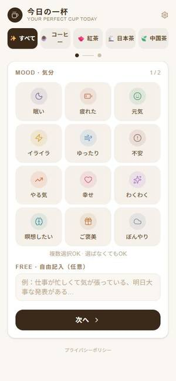
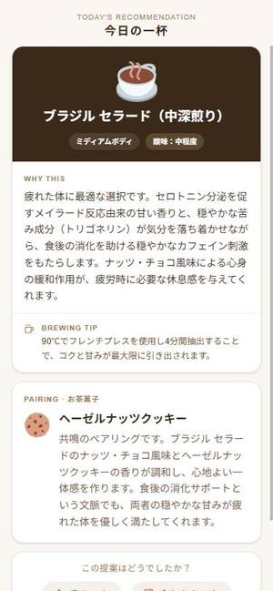

# 🍵 今日の一杯 — Your Perfect Cup Today

**Pick your mood and how you feel → Claude suggests the drink (and a snack) that fits you right now.**
気分と体調を選ぶだけで、今のあなたに合う一杯とお菓子をAIが提案するWebアプリです。

🔗 **Live demo:** https://y-liard-gamma.vercel.app

<p>
  
  &nbsp;&nbsp;
  
</p>

---

## Why I built it

My family loves tea, and every day the question was the same: *"What should I drink right now?"*
Search engines give generic answers. I wanted something that looks at **today's** mood and body condition and explains *why* a drink fits — so I built it with Claude.

お茶好きの家族のために作りました。「今なに飲もう？」に、その日の気分と体調から理由つきで答えてくれるアプリです。

## Features

- **2-step input** — choose your mood (12 options) and condition (18 options), plus an optional free-text note
- **Category filter** — coffee / black & herbal tea / Japanese tea / Chinese tea
- **Explained recommendations** — Claude picks one drink from a curated database and explains it with the active compounds (L-theanine, caffeine, catechins, polyphenols…), plus a brewing tip
- **Snack pairing** — chooses a snack using *contrast* (sweet × bitter) or *resonance* (similar aromas) pairing principles
- **Learns your taste** — 👍 / 👎 feedback is stored in the browser and fed back into the prompt (no server-side personal data)
- **Shop mode** — cafés can register their own menu, "today's pick" drinks and snacks, then share it as a **URL / QR code** so customers get recommendations from that shop's menu

## How it works

```
Browser (Next.js)                     Server (Route Handler)              Claude API
─────────────────                     ──────────────────────              ──────────
mood / condition / free text   ──▶   /api/recommend
+ likes / dislikes (localStorage)      buildPrompt()                ──▶  claude-haiku-4-5
+ shop menu (optional)                   • filter drink DB by category     returns JSON:
                                         • inject rules & preferences      drink, reason,
result page  ◀───────────────────────   parse JSON  ◀─────────────────    brewing tip, snack
```

### Prompt design highlights

- The model may only choose from a **fixed drink list** (with properties, "good for" / "avoid when" keywords and pairings), which keeps answers grounded and prevents hallucinated drinks
- **Hard safety rules**: no high-caffeine drinks for "can't sleep", "anxious" or "heavy stomach"; never repeat a disliked drink
- The user's own words (free text) get **top priority** and are referenced in the explanation
- Output is constrained to a **JSON schema**, then parsed and validated on the server
- Uses **Claude Haiku** to keep the cost per recommendation very low

## Tech stack

| Area | Tech |
|---|---|
| Framework | Next.js (App Router), React, TypeScript |
| Styling | Tailwind CSS, Lucide icons, Twemoji |
| AI | Claude API (`claude-haiku-4-5`) via `@anthropic-ai/sdk` |
| Storage | localStorage (preferences stay on the device) |
| Hosting | Vercel |

## Run locally

```bash
git clone https://github.com/haru-dev15/drink-recommender.git
cd drink-recommender
npm install
echo "ANTHROPIC_API_KEY=your_key_here" > .env.local
npm run dev
# open http://localhost:3000
```

## Project structure

```
app/
  page.tsx             mood → condition input
  result/page.tsx      recommendation, pairing, feedback, share
  shop/page.tsx        shop mode: menu setup + URL / QR code
  settings/page.tsx    drinks you have at home
  api/recommend/       calls the Claude API
lib/
  drinks.ts            curated drink database
  prompt.ts            prompt builder
  preferences.ts       like / dislike history (localStorage)
```

## Roadmap

- More Japanese and Chinese teas
- Usage limits + a small subscription for heavy users
- iOS app (Expo / React Native, reusing the web logic)

---

> This app gives general suggestions about drinks and is not medical advice.
